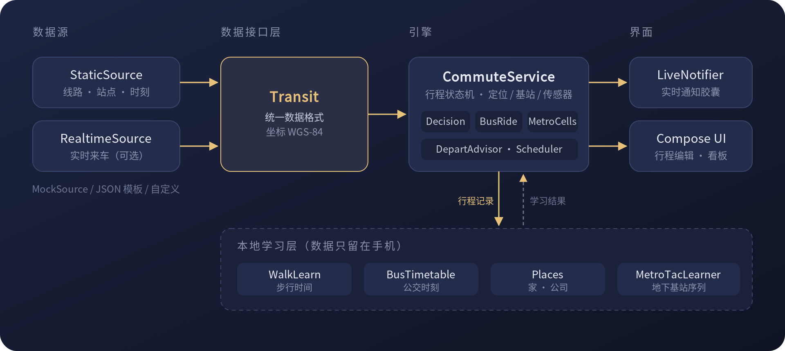

# 通勤胶囊 CommuteCapsule

一个本地优先的 Android 通勤陪伴 App：自动识别你什么时候出门、坐的是哪段公交或地铁、还剩几站，在系统的实时通知胶囊里一路提醒，到站前叫你下车。所有学习都在手机本地完成，不上传任何行程数据。

> 本仓库只包含引擎、界面和通用数据接口，**不包含任何真实线路、站点或到站数据**。装上后默认使用内置的虚构城市「演示城市」，可以把完整流程走一遍。


<sub>演示模式实机录屏（1.6 倍速，站点均为虚构）。完整演示视频（2 分 14 秒，含音频）：[docs/media/demo.mp4](docs/media/demo.mp4)</sub>

## 能做什么

- **多段行程**：公交 / 地铁 / 自定义班车混合换乘，每段可设多个候选，哪个先来坐哪个
- **自动开始与结束**：按时间窗 + 离开常去地点自动弹出，到家 / 到公司自动收起；用户设的时间窗程序绝不自动修改
- **地下也能追踪**：坐地铁时没有 GPS，用手机连接的基站区号（TAC / eNB）学习「在地下的第几段」，推算还剩几站
- **三级降级**：实时到站 → 本机学到的时刻表 → 按站距和间隔的先验估算；没有实时数据也能用
- **省电与保活**：精确闹钟分段唤醒、熄屏冻结检测、被杀后恢复且不重复提醒
- **回放**：行程记录可导出，用于离线回放和回归测试；内置演示回放（虚构数据）

## 架构



- `Transit.kt`：数据接口层。定义线路、站点、来车信息的统一格式，以及数据源要实现的两个接口（`StaticSource` / `RealtimeSource`）。引擎只认这层，换数据源不用改引擎；坐标统一 WGS-84
- `MockSource.kt`：内置虚构数据源，也是实现新数据源的参考
- 纯决策逻辑都在普通 Kotlin 类里，有 JVM 单元测试（`gradle testDebugUnitTest`）

## 接入你自己的数据

最快的方式是用模板：

```bash
cp -r examples/json-source app/src/extra   # 复制模板
# 编辑 app/src/extra/assets/transit.json，填你的线路和站点
```

然后推送或本地编译即可。`app/src/extra` 存在时会自动编进 App，菜单「数据源」里能看到。详见 [examples/json-source](examples/json-source)。

想接实时来车或别的数据，实现 `StaticSource` / `RealtimeSource` 两个接口，见 [docs/DATA_SOURCE.md](docs/DATA_SOURCE.md)。数据从哪里来、是否被允许使用，由使用者自己负责；本仓库不提供、不推荐任何具体数据源。

## 权限与隐私

每个权限的用途见 [PRIVACY.md](PRIVACY.md)。所有记录存在本机，只有你主动导出时才会离开手机。

## 构建

推送到 GitHub 后 Actions 自动编译并跑单元测试；打 `v主.次.修订` 标签时发布正式版到 Releases，说明取自 [CHANGELOG.md](CHANGELOG.md)。默认包名为 `io.github.commutecapsule`，可通过环境变量 `APP_ID` 修改。需要固定签名时，在仓库 Secrets 里配置 `SIGNING_KEYSTORE_B64`、`SIGNING_STORE_PASSWORD`、`SIGNING_KEY_ALIAS`、`SIGNING_KEY_PASSWORD`；不配置则使用 Android 默认调试签名。

要求 Android 12+（`minSdk 31`），实时通知胶囊需要 Android 16。

## 许可

[AGPL-3.0](LICENSE)。
